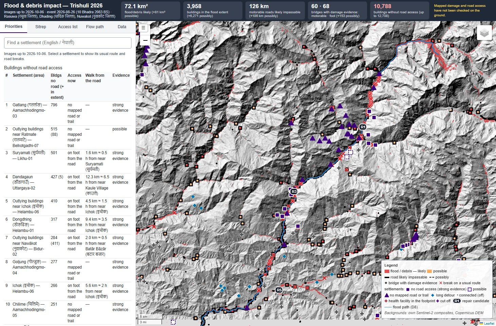

# Satellite Flood Mapping and Road Access

Team riwaq: Sadat Bashir and Adfar Jaan.

Mountain floods leave debris on the valley floor after the water has receded, which limits the extent obtained
from water segmentation. The flood extent is obtained from Sentinel-1 and Sentinel-2
images acquired before and after the flood, using radar backscatter change, optical change and water predictions,
with slope and height above drainage limiting detections on the valley sides. Buildings, roads and bridges are
taken from pre-event OpenStreetMap and compared with the flood extent. Roads affected by the flood are then
removed from the road network, which allows settlements that have lost a route to a town or hospital to be identified.

The case study is the Bhote Koshi–Trishuli flood of 26 August 2026, evaluated against Copernicus EMS activation
**EMSR927** and the UNOSAT corridor map. Trishuli was used to select settings during development.

The mapped infrastructure damage and road access have not been checked on the ground.



[Dashboard](results/case_study_trishuli_2026/dashboard.html) ·
[English situation report](results/case_study_trishuli_2026/sitrep.pdf) ·
[Nepali situation report](results/case_study_trishuli_2026/sitrep_ne.pdf) ·
[Technical report](docs/report/REPORT.pdf) · [LaTeX source](docs/report/REPORT.tex) ·
[Demo video](video/trishuli_flood_mapping_demo_revised.mp4) · [Upload figures](upload_figures)

## Method

Radar acquisitions are compared within each orbit track. A different track views the valley from a different
direction, changing the backscatter and the ground visible to the radar, so it cannot serve as the before image
for that comparison. Pre-event pairs from the same track are used to estimate the change threshold. Both
increases and decreases in backscatter are tested, since rough debris and smooth water can produce opposite
changes. Sentinel-2 supplies vegetation loss, bare-ground change and new water in cloud-free images; debris
change must remain visible in the later composite, while early water is retained because it can recede.

Three radar U-Nets trained on Kuro Siwo and Sen1Floods11, and an optical U-Net trained on Sen1Floods11, predict
water. Mountain detections must connect to a river channel, and radar water predictions also require measured
change nearby. On large low plains, water already present in the before images can produce little additional
change, so the extent is taken directly from the water predictions. Cloud-covered ground in a confined valley
is assigned an extent using the flood level estimated along the river. This part of the extent is labelled
inferred and does not establish strong evidence of a road break.

Road and trail routes are calculated before and after the affected segments are removed. For each settlement
without a road route, the dashboard shows the breaks on its usual route; where a trail remains, walking time is
estimated from the elevation model. Repair candidates are ranked by the number of buildings reconnected.
A supplied upstream point can also be traced through the drainage network to list settlements along its path.

## Flood extent

| Events | F1 | F1 without Sentinel-2 | Evaluation |
|---|---|---|---|
| Trishuli vs EMSR927, 4 AOIs pooled | **0.906** | — | Development case study |
| 12 development events, current optical selection | 0.535 | 0.417 | Used to select settings |
| 12 development events, 14 October benchmark | 0.534 | 0.417 | Used to select settings |
| 5 initial hold-out events, first evaluation | 0.499 | 0.439 | Scored before selection on these events |
| Same 5 events, final system | 0.589 | 0.579 | Three events subsequently used to design the plains rule |
| 3 locked events | 0.366 | 0.294 | Scored once; not used for later selection |
| 5 fresh lowland events | **0.704** | **0.654** | Used to compare candidate rules |
| 2 fresh mountain events | 0.385 | 0.178 | Scored once |
| 2 additional flood areas | 0.356 | 0.325 | Tzermiado and San Sebastiano; used to check the specified change in date selection |

The locked-event scores are 0.666 for Thame, 0.424 for Buner and 0.009 for Charikar. The narrow urban flood trace
at Charikar was largely missed, whereas the wider flood and debris extent at Thame was partly recovered.
Kłodzko and Cantiano have mean F1 0.385. For the five fresh lowland events, the first three informed the combined
water rule; the rule was specified before Sharaqpur and Jamalpur were scored, and accepted using their scores.

Snow is excluded when selecting Sentinel-2 dates, since snow-covered pixels are also excluded from the
reflectance composites. This raised Kaski F1 from 0.570 to 0.591 and changed the twelve-event mean from 0.5335 to
0.5351; the paired 95% interval for the change is −0.0003 to +0.0051. Tzermiado and San Sebastiano score 0.477 and
0.235 with either selection, so the change has not improved these additional flood cases.

### Baselines: 27-event benchmark, 14 October

| Evaluation set | Final | Earlier version | UN-SPIDER | Otsu | Radar change test | Radar water model | Optical water model | Radar or optical water model |
|---|---|---|---|---|---|---|---|---|
| 12 development events | **0.534** | 0.527 | 0.158 | 0.151 | 0.258 | 0.225 | 0.206 | 0.238 |
| 5 hold-out events | **0.589** | 0.483 | 0.419 | 0.409 | 0.445 | 0.535 | 0.166 | 0.539 |
| 2 fresh mountain events | 0.385 | **0.396** | 0.063 | 0.086 | 0.074 | 0.029 | 0.021 | 0.029 |
| 5 fresh lowland events | 0.704 | 0.623 | 0.540 | 0.542 | 0.383 | 0.667 | 0.515 | **0.726** |
| 3 locked events | **0.366** | 0.347 | 0.049 | 0.090 | 0.176 | 0.115 | 0.066 | 0.126 |
| All 27 events | **0.546** | 0.507 | 0.258 | 0.259 | 0.293 | 0.337 | 0.226 | 0.356 |

The UN-SPIDER implementation uses the run's stable-water mask and Copernicus DEM in place of JRC water and
HydroSHEDS terrain. All maps are compared within the same reference extents.

### Water segmentation

| Optical U-Net test | Water IoU | F1 |
|---|---|---|
| Sen1Floods11 held-out test | 0.833 | 0.909 |
| Bolivia | 0.796 | 0.886 |

## Case-study outputs

The Trishuli run maps 72.1 km² as likely affected, with 3,958 buildings in that extent and 126 km of motorable road
estimated to be impassable. The access calculation identifies 10,788 buildings without road access in 58 named
settlements. Of these buildings, 4,415 have no mapped trail avoiding the flood extent. Using EMS-graded road and bridge breaks in the same road network gives agreement at F1 0.854 for buildings
without road access.

| File | Contents |
|---|---|
| `report/dashboard.html` | Flood extent, infrastructure status, settlements, routes and repair candidates |
| `report/sitrep.md`, `report/sitrep.html` | English situation report |
| `report/sitrep_ne.md`, `report/sitrep_ne.html` | Nepali situation report with the same counts |
| `report/*.geojson`, `impact/*.gpkg`, `report/*.csv` | Map layers and settlement lists |
| `summary.json` | Counts, acquisition dates, parameters, timings and errors |

The dashboard embeds its map data in one HTML file. Its Leaflet and other display libraries load from the internet.

## Run

Use Linux and Python 3.11 or later. The measured CPU runs used 8 vCPUs and 50 GB RAM; a CUDA GPU reduces model inference
time. Install the Python dependencies and the tools for downloading and reading OSM extracts, then place the four model
folders under `models/`.

```bash
pip install -r requirements.txt
sudo apt-get install -y osmium-tool aria2
python -m pyproj sync --file us_nga_egm08_25
export TRI_ROOT=$PWD/runs TRI_MODELS=$PWD/models
python src/preflight.py
python src/pipeline.py --event trishuli_2026 --bbox 84.85 27.75 85.65 28.45 --date 2026-08-26 --source 85.50 28.31
```

Each of `models/r34_scratch_v2`, `models/r50_scratch_v2`, `models/r34_s1f11rl_v1` and `models/s2ai_r34_v1` must contain
`best.pt` and `config.json`. The model files are provided in the local `models/` folder. Runs without these weights use
the change rules and record missing water predictions in `summary.json`.

The full Trishuli area took 1 h 51 min on CPU. An unseen 1,311 km² area covering the Sikkim GLOF took 36.5 min on an L4
GPU VM. Acquisition downloads accounted for most of the GPU run time. Smaller CPU runs of 500–1,500 km² took 19–46 min.
[Running instructions](docs/RUNNING.md) · [Method](docs/METHOD.md) · [Evaluation](docs/EVALUATION_PROTOCOL.md)

## Data and attribution

Sentinel-1 GRD, Sentinel-2 L2A and Copernicus DEM GLO-30 are obtained from Microsoft Planetary Computer. OpenStreetMap
is taken from a dated Geofabrik extract or a historical Overpass/ohsome query, and its timestamp is checked against the
event. Published damage maps and post-event OSM are restricted to evaluation.

Contains modified Copernicus Sentinel data 2026 (and 2017–2025 for the evaluation events). Produced using Copernicus
WorldDEM-30 © DLR e.V. 2010–2014 and © Airbus Defence and Space GmbH 2014–2018 provided under COPERNICUS by the European Union
and ESA; all rights reserved. © OpenStreetMap contributors (derived layers under ODbL). Training data: Bountos et al. 2024
(Kuro Siwo, NeurIPS Datasets and Benchmarks); Bonafilia et al. 2020 (Sen1Floods11, CVPR Workshops). Validation only: European
Union, Copernicus Emergency Management Service data; UNOSAT. Claude and Codex were used to edit code and documentation.
