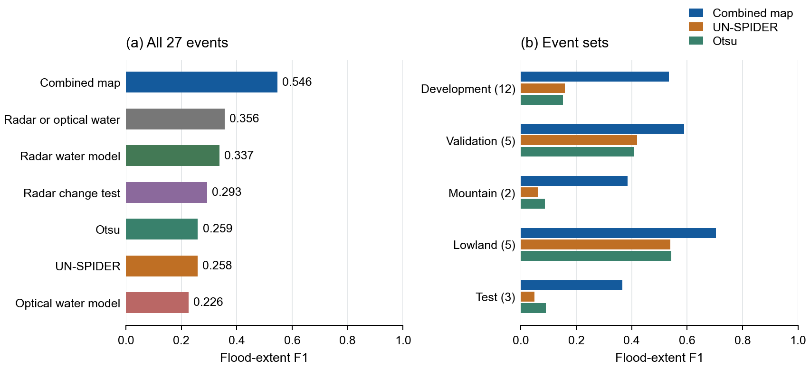
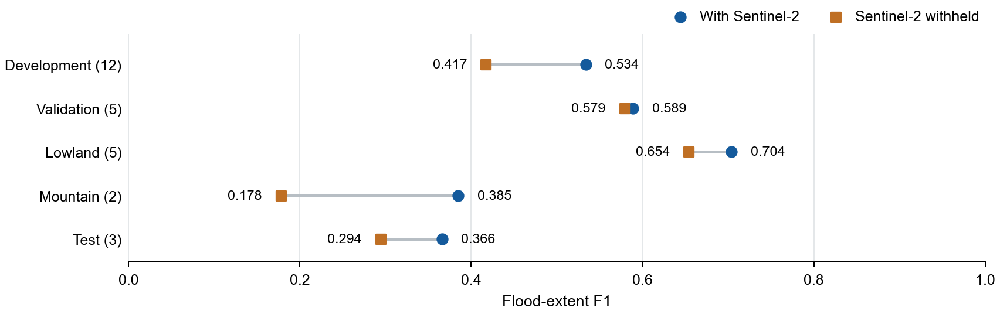
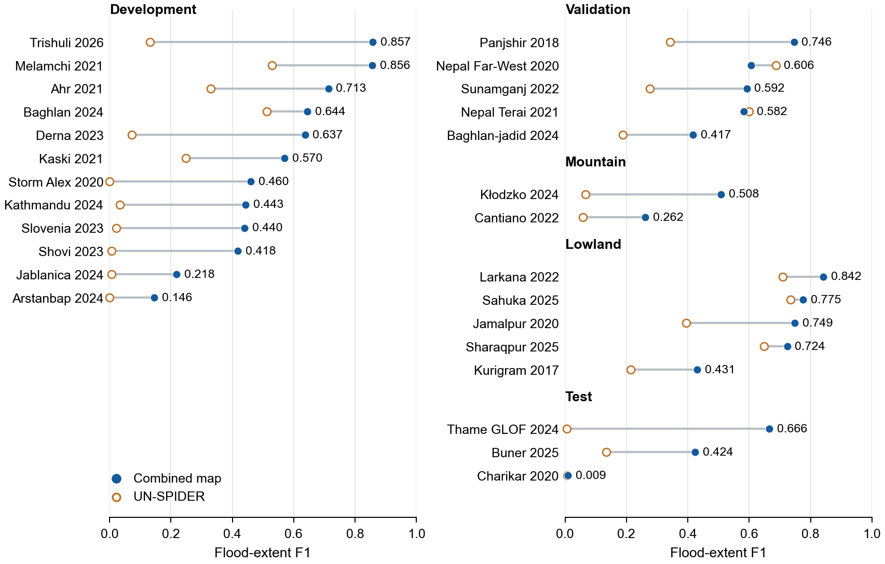
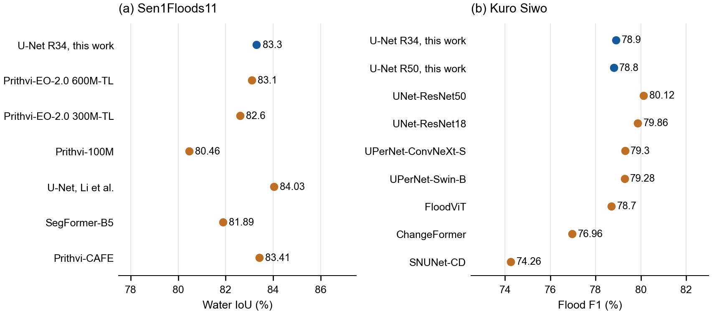

# Results

## 1. Mapping quality

### Optical image selection, 15 October

Snow-covered pixels contributed to the clear-cover fraction used to select Sentinel-2 dates, although snow was
removed when the reflectance composites were made. Excluding snow from date selection raised Kaski F1 from
0.570 to 0.591, while Melamchi decreased from 0.856 to 0.855 and the chosen dates were unchanged for the other
ten development events. The twelve-event mean changed from 0.5335 to 0.5351, with a paired 95% bootstrap interval
for the change from −0.0003 to +0.0051.

| Development comparison | Previous selection F1 | Snow excluded F1 |
|---|---|---|
| Kaski 2021 | 0.5704 | 0.5906 |
| Melamchi 2021 | 0.8558 | 0.8546 |
| All 12 development events | 0.5335 | 0.5351 |

[Per-event comparisons](../results/evaluation/mountain_tests.json).

The additional flood areas at Tzermiado and San Sebastiano were mapped before their reference geometries were
read. Excluding snow leaves the selected dates unchanged in both areas and therefore produces the same maps.
Their scores were used to retain the correction after the development comparison.

| Additional area | Reference | Previous F1 | Snow excluded F1 | F1 without Sentinel-2 |
|---|---|---|---|---|
| Tzermiado 2026 | EMSR933 AOI03, GeoEye-1 | 0.4772 | 0.4772 | 0.5477 |
| San Sebastiano da Po 2025 | EMSR800 AOI01, Pléiades | 0.2347 | 0.2347 | 0.1020 |
| Viksdalen 2024, landslide | EMSR775 AOI11, Pléiades | 0.0004 | 0.0004 | 0.0000 |

The Viksdalen product contains one 0.16 ha landslide polygon, represented by thirteen cells on the 10 m grid;
its score is retained separately from the two additional flood cases. At Tzermiado, the combined map detects
90.5% of the reference extent, although it maps 10.50 km² within the analysed region against 3.76 km² in the
reference, giving precision 0.324. With Sentinel-2 withheld, F1 increases from 0.477 to 0.548 as fewer extra areas
are included.

[Tzermiado comparison](../results/evaluation/additional_areas/tzermiado_2026/comparison.png) ·
[San Sebastiano comparison](../results/evaluation/additional_areas/san_sebastiano_2025/comparison.png) ·
[Viksdalen landslide comparison](../results/evaluation/additional_areas/viksdalen_2024/comparison.png).

### 27-event benchmark, 14 October

| Events | Final F1 | Final F1 without Sentinel-2 | Earlier F1 | Earlier F1 without Sentinel-2 | Evaluation |
|---|---|---|---|---|---|
| 12 development events | **0.534** | 0.417 | 0.527 | 0.371 | Used to select settings |
| 5 initial hold-out events, first evaluation | **0.499** | 0.439 | 0.483 | 0.429 | Scored before selection on them |
| Same 5 events, final system | 0.589 | 0.579 | — | — | Three lowland events subsequently used to design the plains rule |
| 5 fresh lowland events | **0.704** | **0.654** | 0.628 | 0.353 | Each candidate scored once; last two events used to accept the specified combined water rule |
| 3 locked events | **0.366** | **0.294** | 0.347 | 0.174 | First raw-data evaluation, scored once |
| Thame 2024 | 0.666 | 0.561 | 0.609 | — | Locked event |
| Buner 2025 | 0.424 | 0.314 | 0.422 | — | Locked event |
| Charikar 2020 | 0.008 | 0.008 | 0.010 | — | First locked evaluation used a plains rule later removed; retained without rescoring |

Comparing the development reference maps with copies displaced by one 10 m pixel gives mean F1 0.872,
with event scores from 0.74 to 0.97. Narrow flood traces lose more overlap under this displacement.

### Lowland events: flood-extent F1

| Event | Final | Earlier | Final, S2 withheld | Earlier, S2 withheld |
|---|---|---|---|---|
| Sahuka 2025 (COSMO-SkyMed) | 0.775 | 0.756 | 0.756 | 0.778 |
| Larkana 2022 (S2) | 0.842 | 0.854 | **0.647** | 0.301 |
| Kurigram 2017 (TerraSAR-X) | **0.431** | 0.151 | **0.477** | 0.046 |
| Sharaqpur 2025 (ICEYE) | 0.724 | 0.698 | **0.708** | 0.496 |
| Jamalpur 2020 (TerraSAR-X) | **0.749** | 0.679 | **0.683** | 0.146 |

The 0.25 km² urban flood trace at Charikar was largely missed by radar change, optical change and the water
models.

## 2. Case study: Trishuli 2026 vs EMSR927
The final Trishuli run started from raw satellite data. Trishuli was used to select settings during
development; its results are in-sample.

| Quantity | Value |
|---|---|
| Footprint F1 vs EMSR927, pooled over AOIs 01/02/03/05 | **0.906** (P 0.906, R 0.907) |
| Per AOI | 0.912 / 0.862 / 0.915 / 0.904 (mean 0.898) |
| vs UNOSAT corridor footprint | **0.815** (P 0.875, R 0.763) |
| Likely + possible, pooled vs EMS | 0.822 |
| Buildings vs EMS damaged (20 m), per AOI | recall 0.68 / 0.84 / 0.81 / 0.55; precision 0.95 / 0.85 / 0.89 / 0.72 |
| Roads vs EMS damaged (length, 20 m), per AOI | recall 0.76 / 0.69 / 0.88 / 0.66; precision 0.81 / 0.73 / 0.83 / 0.71 |
| Road-access comparison using EMS-graded breaks in the same graph (EMS area) | buildings without road access P 0.874, R 0.835, **F1 0.854** |
| Cut-off check against news reports (Nepal events, earlier map; provisional) | 11 of 16 reported isolations reproduced |

### Infrastructure and access

- flood extent 72.1 km² likely (153.1 incl. possible); 53.4 km² not observable; 4.6 km² estimated beneath cloud;
- 3,958 buildings in the footprint (of 316,712);
- 126 km of motorable road likely impassable (of 7,815);
- bridges with damage evidence: 60 motorable + 68 foot;
- 3 health facilities in the footprint, 2 cut off;
- **10,788 buildings without road access in 58 named settlements** (strong evidence), 4,415 with no mapped road or trail connection;
- first repair candidate: 8.8 km incl. a bridge on NH42 near Khangjim reconnects 2,993 buildings.

## 3. Water segmentation and added observations

| Quantity | Value |
|---|---|
| Radar water model: Kuro Siwo test, flood F1 (observed during development; no selection afterwards) | 0.780–0.789 |
| Optical water model: Sen1Floods11 held-out test (scored once) | IoU 0.833, F1 0.909 (P 0.937, R 0.883); Bolivia (unseen country) IoU 0.796, F1 0.886 |
| Optical water model in the fusion (12 dev events, rule fixed before scoring) | +0.0066 [90 % CI +0.0001, +0.0138] |
| Stand-alone maps, 12 dev events, F1 in extent / below HAND 40 m: S1 rule, radar water model, optical water model, **radar ∪ optical** | 0.201/0.323, 0.209/0.323, 0.204/0.227, **0.221/0.350** |
| Same, 4 Himalayan events, below HAND 40 m | S1 rule 0.446, radar water model 0.518, **union 0.555** |
| Stand-alone, inner hold-out (5) | S1 rule 0.428, radar water model 0.535, optical water model 0.166, **union 0.539** |
| Stand-alone, 5 fresh lowland events | S1 rule 0.427, radar water model 0.667, optical water model 0.400, **union 0.716** |
| Stand-alone, locked (3), in extent / below HAND 40 m | union 0.126 / 0.224 (radar water model 0.115 / 0.190) |
| Estimated flood level, Sentinel-2 withheld (12 dev events, rule fixed before scoring) | 0.371 → 0.417 (+0.046 [+0.023, +0.073], 10 up / 0 down) |

Kuro Siwo and Sen1Floods11 label open water. Mountain reference maps, including EMSR927, also contain
deposited debris and flood traces identified in very-high-resolution optical images acquired days later. Much
of this ground is missed by the radar water model after the water has receded. Optical change restricted by
terrain supplies most of the debris extent, while water segmentation gives higher scores on lowland floods.

## 4. Benchmarks: 27 events, 14 October

[Benchmark results](../results/evaluation/benchmarks/).

<!-- BENCHTAB START -->
| Evaluation set | Final | Earlier version | UN-SPIDER | Otsu | Radar change test | Radar water model | Optical water model | Radar or optical water model |
|---|---|---|---|---|---|---|---|---|
| 12 development events | **0.534** | 0.527 | 0.158 | 0.151 | 0.258 | 0.225 | 0.206 | 0.238 |
| 5 hold-out eventsa | **0.589** | 0.483 | 0.419 | 0.409 | 0.445 | 0.535 | 0.166 | 0.539 |
| 2 fresh mountain events | 0.385 | **0.396** | 0.063 | 0.086 | 0.074 | 0.029 | 0.021 | 0.029 |
| 5 fresh lowland eventsb | 0.704 | 0.623 | 0.540 | 0.542 | 0.383 | 0.667 | 0.515 | **0.726** |
| 3 locked events | **0.366** | 0.347 | 0.049 | 0.090 | 0.176 | 0.115 | 0.066 | 0.126 |
| All 27 events | **0.546** | 0.507 | 0.258 | 0.259 | 0.293 | 0.337 | 0.226 | 0.356 |

The earlier version is the 10 October system, before the large-plain rule, optical U-Net and estimated flood levels. a The first evaluation preceded selection on these events (mean F1 0.499); their three lowland events were later used to design the plains rule. b The combined water rule was specified before Sharaqpur and Jamalpur were scored; their scores were used to accept it.

### Flood-extent F1 by event

| Set | Event | ref km² | Final | Earlier version | UN-SPIDER | Otsu | Radar change test | Radar water model | Optical water model | Radar or optical water model |
|---|---|---|---|---|---|---|---|---|---|---|
| development | melamchi_2021g | 1.2 | **0.856** | 0.854 | 0.529 | 0.501 | 0.511 | 0.601 | 0.650 | 0.628 |
| development | kaski_2021g | 24.6 | 0.570 | 0.528 | 0.248 | 0.346 | 0.231 | 0.451 | **0.573** | 0.491 |
| development | shovi_2023 | 2.2 | **0.418** | 0.383 | 0.006 | 0.008 | 0.097 | 0.033 | 0.157 | 0.040 |
| development | arstanbap_2024 | 0.8 | 0.146 | **0.147** | 0.000 | 0.048 | 0.042 | 0.011 | 0.016 | 0.013 |
| development | baghlan_2024 | 68.3 | **0.644** | 0.644 | 0.513 | 0.323 | 0.411 | 0.484 | 0.006 | 0.486 |
| development | kathmandu_2024 | 7.6 | **0.443** | 0.440 | 0.034 | 0.032 | 0.133 | 0.055 | 0.089 | 0.058 |
| development | alex_2020 | 1.3 | 0.460 | **0.463** | 0.000 | 0.013 | 0.129 | 0.023 | 0.270 | 0.041 |
| development | jablanica_2024 | 2.0 | 0.218 | **0.222** | 0.006 | 0.006 | 0.077 | 0.036 | 0.094 | 0.039 |
| development | derna_2023 | 6.2 | 0.637 | **0.638** | 0.073 | 0.046 | 0.300 | 0.233 | 0.069 | 0.235 |
| development | slovenia_2023 | 3.4 | 0.440 | **0.441** | 0.022 | 0.085 | 0.088 | 0.026 | 0.064 | 0.027 |
| development | ahr_2021 | 4.8 | **0.713** | 0.712 | 0.330 | 0.307 | 0.513 | 0.274 | 0.192 | 0.276 |
| development | trishuli_2026g | 43.8 | **0.857** | 0.850 | 0.131 | 0.092 | 0.566 | 0.467 | 0.290 | 0.522 |
| hold-out | panjshir_2018 | 0.6 | 0.746 | **0.750** | 0.343 | 0.352 | 0.574 | 0.407 | 0.059 | 0.414 |
| hold-out | afg_baghlanjadid_2024 | 4.1 | **0.417** | 0.304 | 0.189 | 0.250 | 0.250 | 0.380 | 0.004 | 0.377 |
| hold-out | nepal_farwest_2020 | 106.3 | 0.606 | 0.549 | **0.687** | 0.635 | 0.660 | 0.619 | 0.106 | 0.604 |
| hold-out | sunamganj_2022 | 809.4 | 0.592 | 0.264 | 0.277 | 0.288 | 0.073 | 0.660 | 0.289 | **0.714** |
| hold-out | nepal_terai_2021 | 414.4 | 0.582 | 0.551 | 0.599 | 0.518 | **0.668** | 0.610 | 0.373 | 0.586 |
| fresh mountain | klodzko_2024 | 1.2 | 0.508 | **0.508** | 0.066 | 0.137 | 0.138 | 0.051 | 0.007 | 0.051 |
| fresh mountain | cantiano_2022 | 1.3 | 0.262 | **0.284** | 0.059 | 0.035 | 0.010 | 0.006 | 0.034 | 0.006 |
| fresh lowland | sahuka_2025 | 223.5 | 0.775 | 0.757 | 0.735 | 0.706 | 0.720 | 0.759 | 0.728 | **0.776** |
| fresh lowland | larkana_2022 | 962.4 | 0.842 | 0.857 | 0.709 | 0.706 | 0.348 | 0.667 | 0.835 | **0.864** |
| fresh lowland | kurigram_2017 | 679.7 | 0.431 | 0.143 | 0.214 | 0.255 | 0.137 | 0.487 | 0.066 | **0.498** |
| fresh lowland | jamalpur_2020 | 859.1 | 0.749 | 0.671 | 0.394 | 0.384 | 0.298 | 0.701 | 0.628 | **0.761** |
| fresh lowland | sharaqpur_2025 | 245.6 | 0.724 | 0.688 | 0.649 | 0.658 | 0.413 | 0.721 | 0.319 | **0.732** |
| locked | thame_2024f | 1.4 | **0.666** | 0.609 | 0.006 | 0.049 | 0.289 | 0.052 | 0.103 | 0.077 |
| locked | buner_2025f | 15.3 | **0.424** | 0.422 | 0.135 | 0.204 | 0.199 | 0.276 | 0.086 | 0.282 |
| locked | charikar_2020f | 0.2 | 0.009 | 0.010 | 0.007 | 0.015 | **0.039** | 0.017 | 0.009 | 0.018 |
<!-- BENCHTAB END -->

- UN-SPIDER = the UN-SPIDER Recommended Practice for Sentinel-1 flood mapping (VH dB after/before > 1.25, 50 m
  smoothing, permanent water / slope < 5° / ≥ 8 px refinements). Our S2 stable water and the Copernicus DEM replace JRC
  and HydroSHEDS. Otsu = Otsu threshold of post-event VV dB on gentle slopes; water after and not before.
- Trishuli: EMSR927 and UNOSAT agree at F1 0.938 where both mapped (49.5 km²). Our map agrees with each at 0.907 /
  0.905; UN-SPIDER at 0.26; radar water model alone at 0.69. Baghlan: the two references (Pléiades, S2) agree at 0.845.
- Charikar (locked): the best of all maps scores 0.04 (radar change test); the final system 0.009.
- Fresh mountain events, scored once: Kłodzko 2024 (EMSR756, WorldView-3) 0.508; Cantiano 2022 (EMSR634) 0.262.

### Published model results

| Sen1Floods11 hand test, S2, water IoU (Bolivia) | | Kuro Siwo test, GRD, flood F1 | |
|---|---|---|---|
| **ours U-Net R34 (scored once)** | **83.3 (79.6)** | **ours, ensemble members** (test observed during development) | **78.9 / 78.8** |
| Prithvi-EO-2.0 600M-TL / 300M-TL (arXiv 2412.02732) | 83.1 / 82.6 | UNet-R50, best (arXiv 2311.12056) | 80.12 |
| Prithvi-100M (HF model card) | 80.46 (77.95) | UNet-R18 | 79.86 |
| U-Net scratch / SegFormer-B5 (arXiv 2309.14500) | 84.03 (70.57) / 81.89 (75.82) | UPerNet-ConvNeXt-S / Swin-B | 79.3 / 79.28 |
| Prithvi-CAFE (arXiv 2601.02315) | 83.41 (81.37) | FloodViT / ChangeFormer / SNUNet-CD | 78.70 / 76.96 / 74.26 |

## 5. Runtime

### CPU runs: 8 vCPU

| Area | km² | Time |
|---|---|---|
| Thame 2024 | ~550 | 24 min |
| Charikar 2020 | 504 | 19 min |
| Buner 2025 | 994 | 41 min |
| Kurigram 2017 | 1,331 | 29 min |
| Sahuka 2025 | 1,470 | 36 min |
| Larkana 2022 | 1,529 | 46 min |
| **Trishuli box** | **6,080** | **1 h 51 min** (radar water model 39 min, S2 18 min, S1 15 min) |

GPU (L4, final code, unseen Sikkim GLOF 2023, 1,311 km²): **36.5 min** end to end. Radar water model 196 s with TTA, optical water model
36 s; data download takes the rest (S2 435 s, OSM 526 s, S1 285 s).

## 6. Evaluation status and limits

The twelve development events include the Trishuli case study and were used to select settings. The initial
hold-out mean of 0.499 was measured before selection on those events; their three lowland events subsequently
informed the mapping of plains. Sharaqpur and Jamalpur were scored after the combined water rule had been specified, and their scores were
used to accept it. The locked-event scores were not used for later selection.

Four early radar variants were compared on the Kuro Siwo test split before two of them were retained in the
ensemble. The optical Sen1Floods11 test and Bolivia splits were scored once with the checkpoint selected on
validation. Kuro Siwo and Sen1Floods11 scores measure water segmentation; the event comparisons also include
debris where it is present in the reference maps.

The Charikar run missed most of a 0.25 km² urban flood trace. At Kurigram, water was present in the pre-event
images and the final map recovered 29% of the reference extent. Buildings within the mapped extent have not been
checked for destruction, and calculated road routes have not been checked on the ground. The satellite images
describe conditions on their acquisition dates and cannot provide warning of a glacier collapse minutes ahead.

The UNOSAT Trishuli reference shares the 27 August optical acquisition with the mapping inputs. Far-West and
Terai use Sentinel-1 references, while the five fresh lowland references use other sensors.

[Evaluation](EVALUATION_PROTOCOL.md).

## 7. Data credits

- "Contains modified Copernicus Sentinel data 2026."
- "Produced using Copernicus WorldDEM-30 © DLR e.V. 2010–2014 and © Airbus Defence and Space GmbH 2014–2018 provided under COPERNICUS by the European Union and ESA; all rights reserved."
- "© OpenStreetMap contributors."
- EMS credit (validation only): "European Union, Copernicus Emergency Management Service data". UNOSAT credit (validation only).
- Training data: Bountos et al. 2024 (Kuro Siwo, NeurIPS Datasets & Benchmarks); Bonafilia et al. 2020 (Sen1Floods11, CVPR Workshops);
  ImageNet-pretrained ResNet-34 (torchvision / segmentation-models-pytorch).
